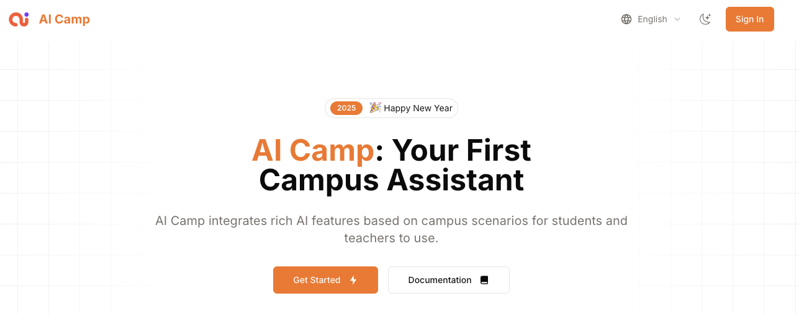

# AI教学搭子

A comprehensive platform offering intelligent educational tools for teachers and students. The platform is available both as a web application (current repository) and as a WeChat Mini Program ([open source on GitHub](https://github.com/SCLS-AI-Camp/AICamp-Mini)).



## 项目简介

This platform provides a collection of AI-powered tools organized into four categories designed to enhance teaching and learning experiences:

### 1. 智慧课堂 (Smart Classroom)
Tools to assist with classroom teaching and lesson preparation:
- 教案设计 (Lesson Plan): Generate structured lesson plans based on specific knowledge points
- 教学材料 (Teaching Materials): Create comprehensive teaching materials
- 选择题 (Quiz): Generate quizzes with customized questions

### 2. 百科大全 (Knowledge Encyclopedia)
Tools for exploring and expanding knowledge:
- 概念背景 (Concept Background): Provide concise explanations of complex concepts
- 句子扩写 (Sentence Expansion): Expand sentences to target word counts with added details

### 3. 创意工坊 (Creativity Lab)
Tools to boost creativity and communication:
- 专业邮件 (Professional Email): Generate professional emails for various contexts
- 每日金句 (Daily Quote): Create inspirational quotes for specific purposes
- 有效沟通 (Effective Communication): Provide communication strategies for different scenarios

### 4. 心灵成长 (Mindful Growth)
Tools for personal growth and reflection:
- 心灵镜像 (Mind Mirror): Analyze emotional states and provide supportive responses


## 技术架构与 Gemma 模型集成流程

### Gemma 模型在架构中的位置

```
+------------------+        +------------------+        +------------------+
|                  |        |                  |        |                  |
|  前端用户界面     |------->|  前端服务层      |------->|  后端API服务     |
|  (Next.js页面)   |        |  (API Service)   |        |  (gen-text API)  |
|                  |        |                  |        |                  |
+------------------+        +------------------+        +--------|---------+
                                                                 |
                                                                 v
                                                        +------------------+
                                                        |                  |
                                                        |  Gemma模型集成   |
                                                        |  (OpenRouter API) |
                                                        |                  |
                                                        +------------------+
```

### Gemma 模型调用流程

1. **前端初始化请求**：
   - 默认使用"openrouter-gemma"提供商
   - 指定"google/gemma-3n-e4b-it:free"模型
   ```typescript
   // api-service.ts中的默认配置
   export async function callGenerationAPI(
     prompt: string, 
     provider: string = "openrouter-gemma",  // 默认使用Gemma
     model: string = "google/gemma-3n-e4b-it:free"
   ): Promise<string>
   ```

2. **前端请求处理**：
   - 构建请求体，包含prompt、provider和model
   - 向`/api/demo/gen-text`端点发送POST请求

3. **后端API路由处理**：
   - 在`route.ts`中识别"openrouter-gemma"提供商
   - 采用直接API调用方式处理Gemma请求
   ```typescript
   case "openrouter-gemma":
     // 使用 OpenAI 客户端直接访问 OpenRouter 的 Gemma
     try {
       const directOpenAI = new OpenAI({
         baseURL: "https://openrouter.ai/api/v1",
         apiKey: process.env.OPENROUTER_API_KEY || "",
         defaultHeaders: {
           "HTTP-Referer": process.env.SITE_URL || "https://ai-camp.vercel.app", 
           "X-Title": "AI Camp",
         },
       });
       
       const result = await directOpenAI.chat.completions.create({
         model: model, // 例如 "google/gemma-3n-e4b-it:free"
         messages: [
           {
             role: "user",
             content: prompt
           }
         ],
       });
       
       // 返回结果，不使用 generateText
       return respData({
         text: result.choices[0].message.content || "",
         reasoning: null,
       });
     } catch (error) {
       console.error("OpenRouter-Gemma direct API error:", error);
       return respErr(`OpenRouter-Gemma API failed: ${(error as Error).message}`);
     }
   ```

4. **Gemma API调用方式**：
   - 使用OpenAI兼容的API格式
   - 通过OpenRouter服务访问Google的Gemma模型
   - 采用完全标准的chat.completions接口

5. **环境配置**：
   - 在`.env.development`中配置OPENROUTER_API_KEY
   - 添加SITE_URL用于API请求引用信息

### Gemma 在项目中的作用

1. **核心功能支持**：为教育工具提供自然语言生成能力
2. **默认模型选择**：作为平台默认的AI生成模型
3. **教育内容生成**：支持各类教育工具，如概念背景、教案设计等
4. **性能优化**：通过直接API调用方式提高响应速度

Gemma模型通过OpenRouter服务集成到系统中，为AI教学搭子提供强大的自然语言处理能力，所有工具默认使用此模型来生成各类教育内容。

## Demo展示

Google Slides 链接：https://docs.google.com/presentation/d/12q4uWQq2fTgVSJ2ss6snVq7peqrqks1Adj3ohLJyzmY/edit?usp=sharing